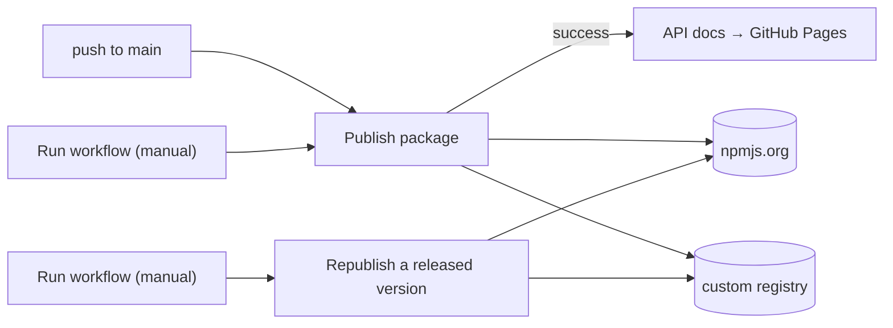

# Building and releasing

How `@helix-x/datagrid-ui` gets built, published and documented: what each GitHub Actions workflow does, what it needs, and what to do when something goes wrong.

- [At a glance](#at-a-glance)
- [One-time repository setup](#one-time-repository-setup)
- [How versions work](#how-versions-work)
- [A normal release](#a-normal-release)
- [Choosing registries](#choosing-registries)
- [Retrying a failed release](#retrying-a-failed-release)
- [Copying a released version to another registry](#copying-a-released-version-to-another-registry)
- [API docs](#api-docs)
- [Release notes and commit messages](#release-notes-and-commit-messages)
- [Running it locally](#running-it-locally)
- [Troubleshooting](#troubleshooting)

## At a glance

There are three workflows and two helper scripts.

| File | Trigger | What it does |
| --- | --- | --- |
| `.github/workflows/publish.yml`, **Publish package** | push to `main`, or a manual run | typecheck, build, write release notes, publish to npmjs.org and/or the custom registry, tag `v<version>`, create the GitHub release, commit the next version bump |
| `.github/workflows/docs.yml`, **API docs** | **Publish package** finishing successfully, or a manual run | build the TypeDoc API reference at the released commit and deploy it to GitHub Pages |
| `.github/workflows/republish.yml`, **Republish a released version** | manual only | copy an already-released version, byte for byte, from one registry to another |
| `.github/scripts/publish.mjs` | used by the workflows and locally | the only code that talks to registries: checks, packs, downloads and publishes |
| `.github/scripts/release-notes.mjs` | used by Publish package and locally | builds the release notes from commits since the previous `v*` tag |



## One-time repository setup

Under **Settings → Secrets and variables → Actions**:

| Name | Kind | Value | Used by |
| --- | --- | --- | --- |
| `NPM_TOKEN` | secret | an npmjs.org **automation** token with publish rights to `@helix-x` | publish, republish |
| `CUSTOM_REGISTRY_AUTH` | secret | base64 of `user:password` for the custom registry, e.g. `printf 'user:pass' \| base64` | publish, republish |
| `CUSTOM_REGISTRY_URL` | **variable** | the custom registry, e.g. `https://packages.allquill.com/repository/allquill-npm/` | publish, republish |

Also check:

- **Settings → Actions → General → Workflow permissions** is set to *Read and write*. The publish job pushes a tag and a bump commit to `main`.
- **Settings → Pages → Source** is set to *GitHub Actions*, for the docs.

There is **no built-in default** for the custom registry. If `CUSTOM_REGISTRY_URL` is unset, any run that targets `custom` or `both` (which includes every push to `main`) fails at the check step, before anything is published. Set the variable, or publish with `target: npm` until you do.

## How versions work

`main` always carries the **next, unpublished** version.

1. A push to `main` publishes whatever version is in `package.json`, say `0.2.0`.
2. After every target has succeeded, the workflow tags `v0.2.0`, creates the GitHub release, then runs `npm version patch` and pushes `chore(release): bump version to 0.2.1 [skip ci]`.
3. `[skip ci]` keeps that bump commit from triggering another release.

To make the next release a minor or major one, there are two options:

- edit `version` in `package.json` (and `package-lock.json`) yourself before pushing, or
- start **Publish package** manually and choose `bump: minor` / `major`. Note that this chooses the bump applied *after* publishing, i.e. the version the release after this one will get.

Never reuse a version: registries reject a version that already exists, even after it has been unpublished.

## A normal release

Push (or merge) to `main`. **Publish package** then runs these steps in order:

1. **Install, typecheck, build.** A failure here stops the run and nothing is published.
2. **Resolve version.** `publish.mjs --check` asks each target registry whether it already has this version. If every target has it, the run is a no-op: re-running on a released commit is harmless. This step also fails early if a target is misconfigured, such as a missing `CUSTOM_REGISTRY_URL`.
3. **Write release notes.** This deliberately runs *before* publishing, so a failure here stops the run while it can still be fixed and retried.
4. **Publish.** `publish.mjs` runs `npm pack` once (which runs `prepack`: clean + build), then publishes **that same tarball** to each target that is still missing the version. Both registries therefore receive identical bytes.
5. **Tag, GitHub release.** These are skipped if the tag or release already exists from an earlier, partially failed run.
6. **Bump version** for the next release, as described above.
7. **API docs** starts on its own once this workflow succeeds.

The concurrency group `publish-npm` makes sure only one publish or republish runs at a time.

## Choosing registries

| Target | Publishes to |
| --- | --- |
| `both` (default for pushes) | npmjs.org **and** `CUSTOM_REGISTRY_URL` |
| `npm` | `https://registry.npmjs.org/` only |
| `custom` | `CUSTOM_REGISTRY_URL` only |

Pushes to `main` always use `both`. To use another target, open **Actions → Publish package → Run workflow** and pick `target`. You can also fill in `custom_registry` to override the URL for that one run.

Two npm behaviours the script handles for you, which are worth knowing if you ever publish by hand:

- **Scope registry beats `--registry`.** The project `.npmrc` maps `@helix-x` to the custom registry (so installs work). For a scoped package npm would follow that mapping even with `--registry` given, so every call also passes `--@helix-x:registry=<target>`.
- **`publishConfig.registry` would override the target**, so `package.json` no longer sets it. Tarballs from older releases still contain it, but npm 10 lets command-line flags win, so they are still published where you point them.

Credentials are passed as environment variables and written to a throwaway npm config as `${VAR}` references. The secret never appears on a command line or in a file.

## Retrying a failed release

Nothing new is needed for this. The version bump only happens after **every** target succeeds, so after a failure `main` still holds the version that didn't make it out.

1. Fix the cause (an expired token, a missing secret, the registry being down, …).
2. Either click **Re-run failed jobs** on the failed run, or start **Actions → Publish package → Run workflow** on `main`.
3. Registries that already have the version are skipped, and only the one that missed it is published. Then the tag, release and bump run.

**Edge case:** if the publish, tag and release all succeeded but the *bump* step failed, a re-run does nothing, because every target already has the version. Bump `package.json` by hand (`npm version patch --no-git-tag-version`) and commit it with `[skip ci]` in the subject.

## Copying a released version to another registry

Use this when a version is already out on one registry and you want it on another as well, for example `0.1.4` from the custom registry onto npmjs.org.

**Actions → Republish a released version → Run workflow**, with these inputs:

| Input | Meaning |
| --- | --- |
| `version` | the released version, e.g. `0.1.4` (required) |
| `target` | where to copy it: `custom` (default), `npm` or `both`. A target that already has it is skipped |
| `custom_registry` | optional URL override for this run |

What it does:

- It finds the first registry (npmjs.org, then `CUSTOM_REGISTRY_URL`) that has the version, whether or not that registry is a target.
- It downloads that exact tarball, checks that the name and version inside match, and publishes it unchanged.
- **Nothing is rebuilt**, so the copy is byte-for-byte the original (same shasum).
- No tag, GitHub release or version bump is made, and `main` is untouched.
- It works for any release, including ones made before this workflow existed.
- If no known registry has the version, the run fails and nothing is published.

## API docs

**API docs** (`docs.yml`) is triggered through `workflow_run` when **Publish package** completes:

- It only deploys when the publish run **succeeded**. A manual run is always allowed.
- It checks out the publish run's `head_sha`, so the docs describe the released code rather than the bump commit pushed on top of it.
- It runs `npx typedoc --treatWarningsAsErrors`, so an exported symbol without a doc comment or a broken `{@link}` fails the deploy.
- It refuses to deploy a suspiciously small build (fewer than 20 pages).

Why `workflow_run` and not `on: release`: the publish job creates its release with the default `GITHUB_TOKEN`, and events raised by that token never trigger other workflows. An `on: release` trigger would simply never fire.

> `docs.yml` refers to the publish workflow **by its `name:`** (`Publish package`). If you rename the publish workflow, update `workflows:` in `docs.yml` too, or the docs will silently stop deploying.

## Release notes and commit messages

`.github/scripts/release-notes.mjs` lists every commit since the previous `v*` tag. It uses commits rather than GitHub's generated notes, which only cover merged pull requests, and `main` is pushed to directly.

- [Conventional Commit](https://www.conventionalcommits.org) prefixes are grouped: `feat:` under Features, `fix:` under Fixes, and `!` or a `BREAKING CHANGE:` footer under Breaking changes. Everything else is listed as written.
- `[skip ci]` bump commits are left out.
- **Commit subjects are published as-is**, so write them for the people installing the package.

## Running it locally

From the repository root:

```bash
npm run publish:check          # which registries already have the package.json version
npm run publish:dry            # pack once and dry-run publish to both registries
npm run publish:npm            # publish to npmjs.org
npm run publish:custom         # publish to CUSTOM_REGISTRY_URL
npm run publish:both           # publish to both
npm run publish:copy -- 0.1.4 npm               # copy a released version to npm
DRY_RUN=1 npm run publish:copy -- 0.1.4 npm     # …as a dry run
node .github/scripts/release-notes.mjs          # preview the next release notes
```

`custom`, `both` and copying from or to the custom registry need `CUSTOM_REGISTRY_URL` exported, e.g. `export CUSTOM_REGISTRY_URL=https://packages.allquill.com/repository/allquill-npm/`.

For credentials, export `NPM_TOKEN` / `CUSTOM_REGISTRY_AUTH`. If one is unset, your own `~/.npmrc` is used instead, so you can rely on `npm login` for npmjs.org and `NPM_TOKEN=<base64 user:pass> npm run registry:login` for the custom registry.

Normally releases go through CI so that tags, GitHub releases and version bumps stay consistent. Publish locally only when you know why.

## Troubleshooting

| Symptom | Cause / fix |
| --- | --- |
| `target "both" needs CUSTOM_REGISTRY_URL; nothing was published` | Set the `CUSTOM_REGISTRY_URL` repository variable, or run with `target: npm`. |
| `missing NPM_TOKEN, CUSTOM_REGISTRY_AUTH; nothing was published` | Add the missing secret(s). In CI this is checked before anything is published. |
| `could not query <url>` with a 401/403 | The credential is wrong or expired. For the custom registry, check it is base64 of `user:password`, not the raw password. |
| `<name>@<x> is on no known registry` (republish) | No registry has that version. Check the version, and that `CUSTOM_REGISTRY_URL` is set if it lives there. |
| Run finished green but published nothing | Every target already had the version. Check `package.json` on `main`, which has probably already been bumped. |
| One registry got the version, the other didn't | Fix the cause and re-run. See [Retrying a failed release](#retrying-a-failed-release). |
| Docs didn't deploy after a release | The publish run must have *succeeded*, and `docs.yml` must name the publish workflow by its exact `name:`. Docs can also be deployed by running **API docs** manually. |
| Push to `main` didn't publish | The head commit message contains `[skip ci]`. |
